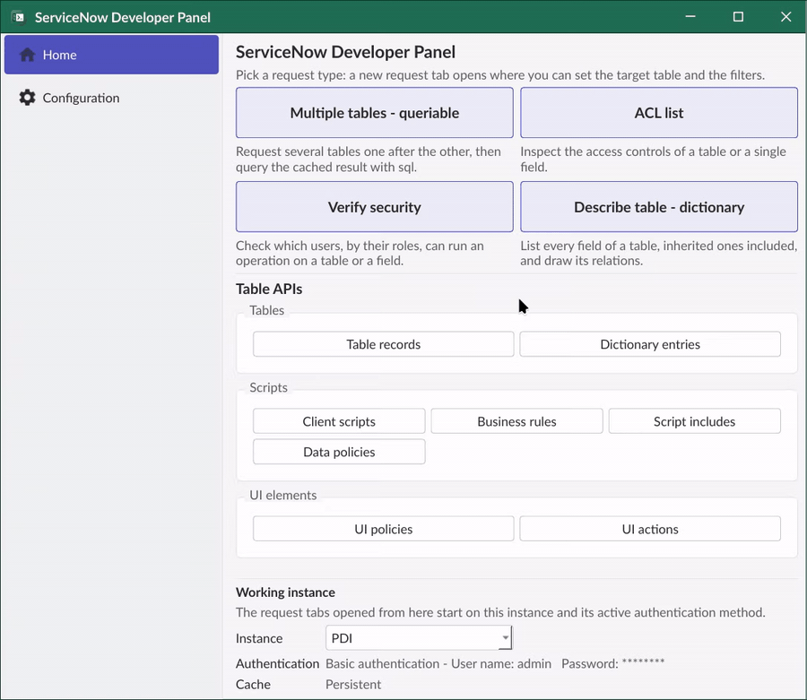
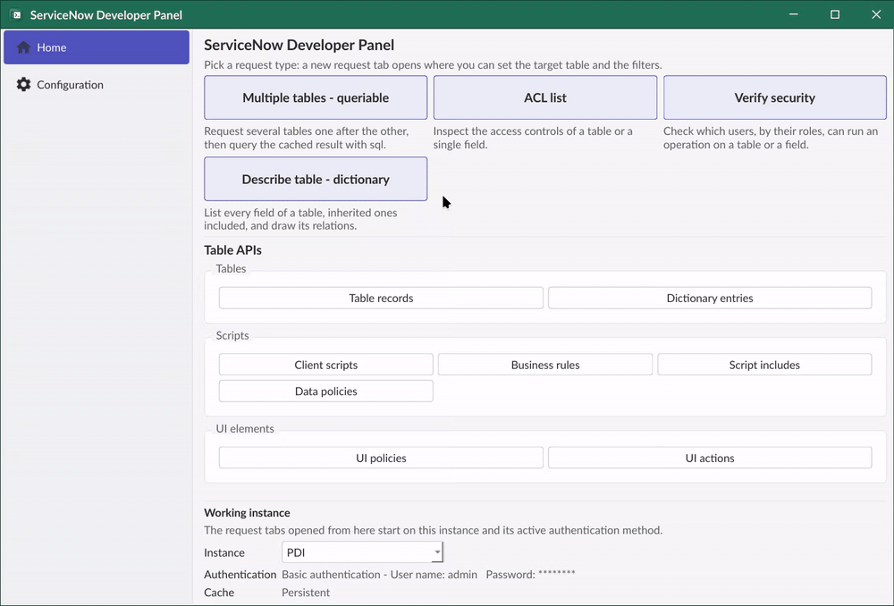
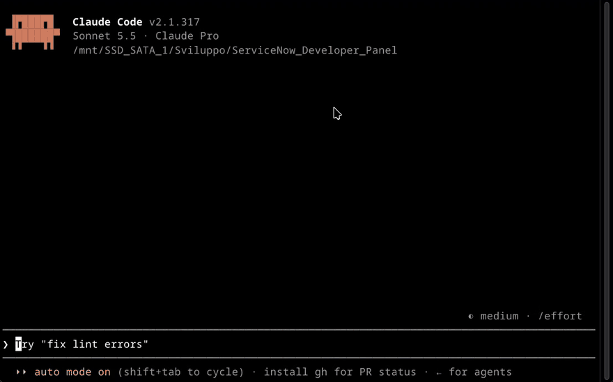

# What is this project

This project is meant as a helper tool for service now developer.
It provides a simple, desktop native UI to make Rest API call to a ServiceNow instance and to browse and query the result.

From standard Table API operations, such as selecting filtered records in a table, you will be able to perform advanced operations, like join operations between tables and grouping.

The same APIs used for the user interface also powers a local MCP server, so your AI model of choice can browse and study your ServiceNow instance.

This tool provides read-only methods, although PUT calls may be added in the future.

# Warning notice

This project is an independent, community tool: it is not affiliated with or endorsed by ServiceNow. ServiceNow is a trademark of ServiceNow, Inc.

This tool pulls data from a selected ServiceNow instance, using user provided authentication, to process it locally. Always make sure not to violate your organization's policies. I do not in any way condone misuse of this tool. To report a vulnerability, or to see what the tool stores and how, read the [security policy](SECURITY.md).

# How to use it

To get started with this tool first configure your instance and authentication methods in the *Configuration* tab. 
Note: Your credentials are only saved locally and sent to ServiceNow to authenticate your requests.

- [Configuration](docs/configuration.md): settings, instances and authentication methods.
- [User interface](docs/user_interface.md): tabs and sidebar.
- [Database](docs/database.md): what is stored locally and where, how responses are reused and when they expire.
- [MCP](docs/mcp.md): the MCP server and its tools.

Each release includes two setup executables, for [Windows](https://github.com/MarcoAcce/ServiceNow_Developer_Panel/releases/latest/download/ServiceNowDeveloperPanelSetup.exe) and for [Linux](https://github.com/MarcoAcce/ServiceNow_Developer_Panel/releases/latest/download/ServiceNowDeveloperPanelSetup-linux-x86_64.tar.gz) . 

Simply download the setup for your system and run it to install the application (portable ~180MB, but you can build the project yourself to save storage). Running a newer setup on an existing installation updates it and keeps your data.

The installers are not code-signed, so Windows SmartScreen may warn you the first time you run the setup. See [Building and installing](docs/build.md) for what to expect, how to verify the download and how to build it yourself.

# Code stuff

This project is written entirely in Python. 
I used `Pyside6` for the UI and the `mcp` package for the MCP server.
The list of packages needed to build this application is in the `requirement.txt` file.

You can build the app or its installer yourself. See [Building and installing](docs/build.md).
