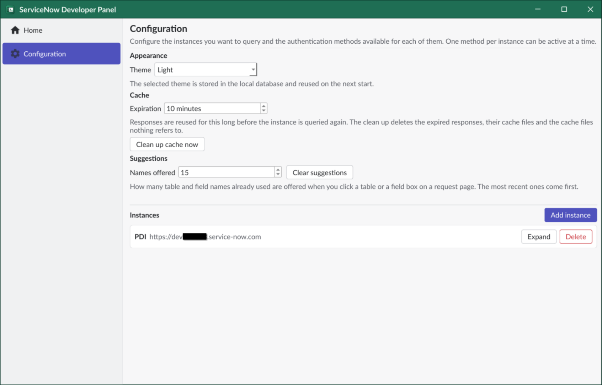

# Configuration

First add your instance and an authentication method in the *Configuration* tab.

## Instances

Click *Add instance*, give it a name and its URL. Use the *Expand* button to manage the
authentication methods for the instance: you can store several of them, but only one per
instance can be active at a time.

## Authentication

Choose your authentication method:

- **Basic authentication**: user name and password, sent on every request.
- **OAuth token**: client id, client secret and refresh token of an OAuth application registry entry. The access token is optional.
- **JWT token**: a signed JWT exchanged for an access token by the instance.

Each instance also has a separate list of *MCP authentication* methods, used only by the local MCP server.

Credentials are encrypted and stored in the local database: they are sent to ServiceNow only to authenticate your requests.

## Settings

- **Theme**: light or dark.
- **Cache expiration**: how long a response is considered valid. *Clean up cache now* removes all expired responses from the database. See [database](database.md).
- **Suggestions**: how many previously used table and field names are suggested on the request page. *Clear suggestions* forgets them.

# Links

- [database](Database.md)
- [MCP server](mcp.md)
- [Back to README](../README.md)