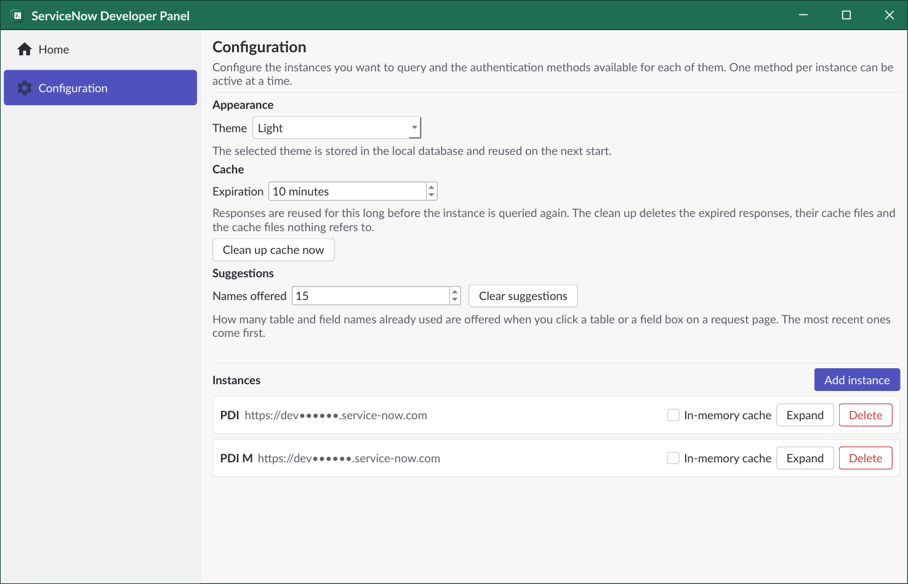

# Configuration

First add your instance and an authentication method in the *Configuration* tab.

## Instances

Click *Add instance*, give it a name and its URL. Use the *Expand* button to manage the
authentication methods for the instance: you can store several of them, but only one per
instance can be active at a time.

## Authentication

Choose your authentication method:

- **Basic authentication**: user name and password, sent on every request.
- **OAuth login**: client id and client secret of an OAuth API endpoint registered on the instance with `http://localhost:8431/oauth/callback` as redirect URL. You log in to the instance in your browser and the panel keeps the tokens it is issued, renewing them on its own. A new OAuth method must be logged in before it can be saved. See [OAuth login](oauth.md) for the setup on the instance and the login flow.

A method added to an instance that has no active method becomes active. Each instance also has a separate list of *MCP authentication* methods, used only by the local MCP server.

Credentials are encrypted and stored in the local database: they are sent to ServiceNow only to authenticate your requests.

## Settings

- **Theme**: light or dark.
- **Cache expiration**: how long a response is considered valid. *Clean up cache now* removes all expired responses from the database. See [database](database.md).
- **Suggestions**: how many previously used table and field names are suggested on the request page. *Clear suggestions* forgets them.

# Links

- [database](database.md)
- [OAuth login](oauth.md)
- [MCP server](mcp.md)
- [Back to README](../README.md)