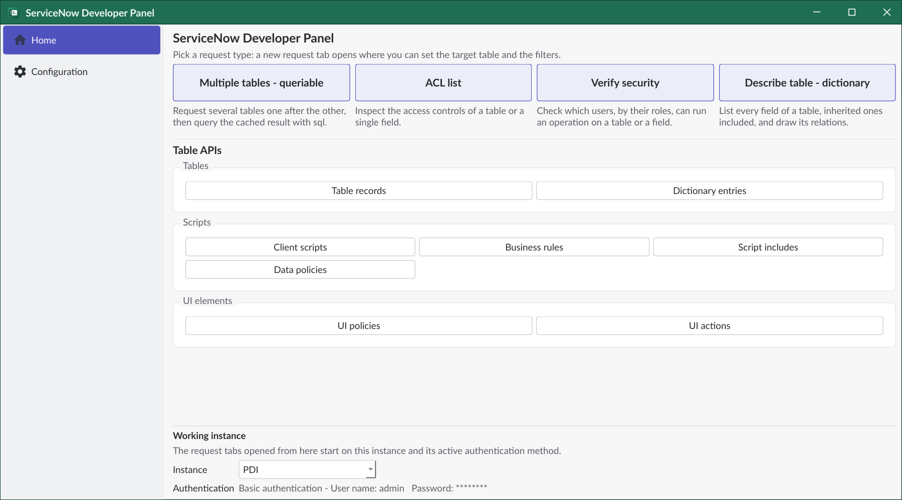
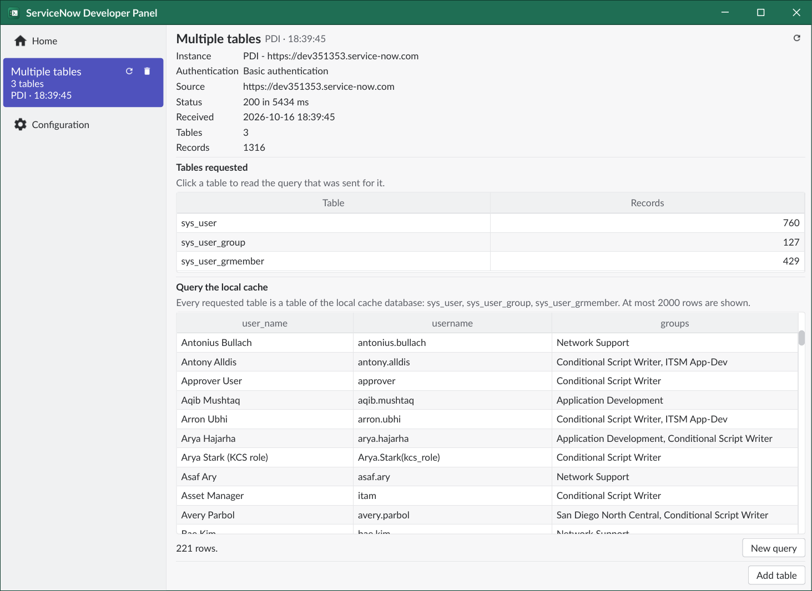
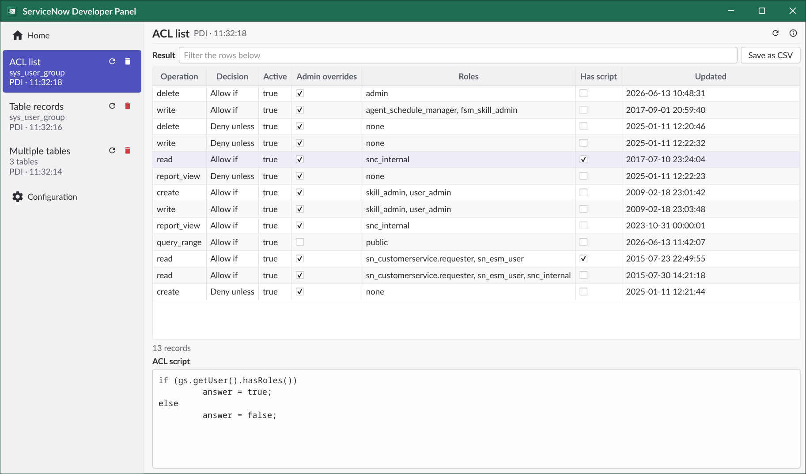
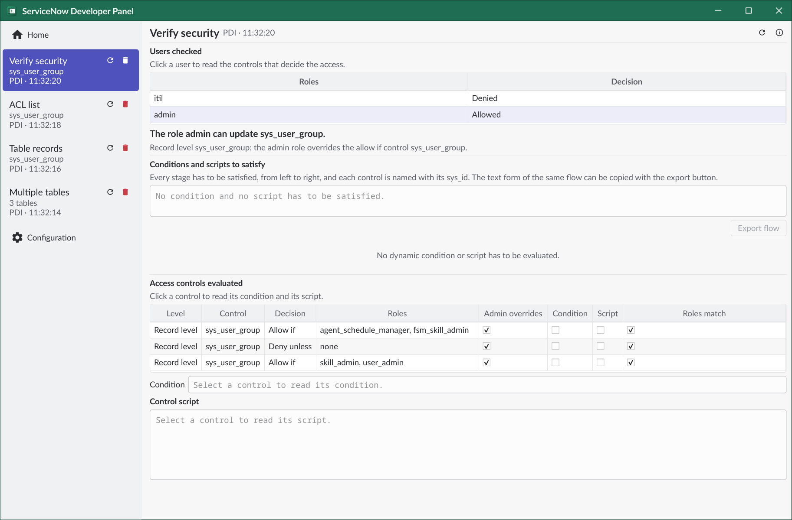

# User interface

## Home

The *Home* tab is where you start a new request. 
Requests are grouped in: tables, security, scripts and UI elements. 
Clicking a request button opens a *new request* tab, where you set the target table and the optional filters. 
The request is sent to the working instance, shown at the bottom of the page.

## Responses

When a response arrives a new tab opens, showing the request details and the records. 
You can filter the rows, order by column, and even save the records as CSV.

The *sidebar* allows you to move between *Home*, *response* tabs and *Configuration*. 

The response tabs are ordered by date and labeled with the target table. 
Each one has a *refresh* button, to send the request again, and a *delete* button, to remove it.

## Advanced requests

Most requests are simple Table API calls, but some are more complex.

### Multiple tables (queriable)

A *Multiple tables* request fetches several tables at once and stores them into the same local database. 
You can then query them together using plain SQL. 
Use the *Add table* button to fetch more tables into the same database.

### ACL list

*ACL list* shows the access controls of a table with their roles.
Selecting one shows its script and conditions.

### Verify security

*Verify security* checks whether a set of users can perform an operation on a table or a field. 
In this context a User signifies a set of roles, checked together against the ACLs.

The response page shows the decision for each user, the controls evaluated and the conditions and scripts still to satisfy. 

### Describe table - Dictionary

*Describe table* pulls a from the dictionary the list of all fields of a table, including those inherited from other tables, and offers a simple interactive UI to see each field's details. 

# Links

- [Back to README](../README.md)
